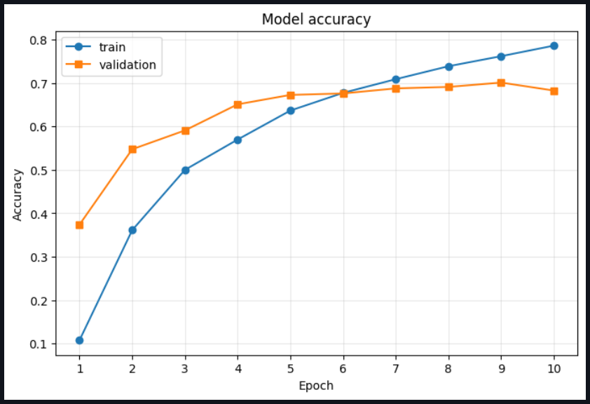
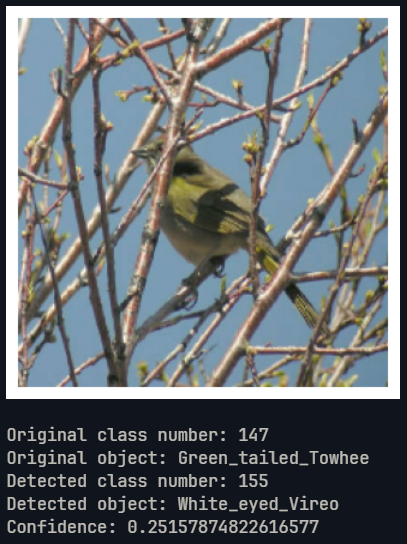
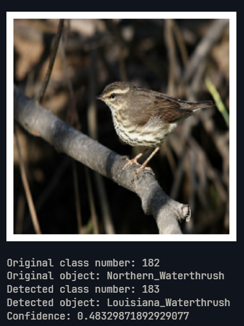
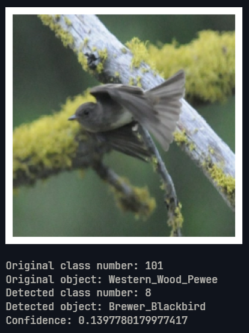
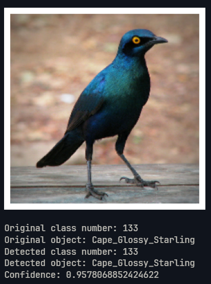
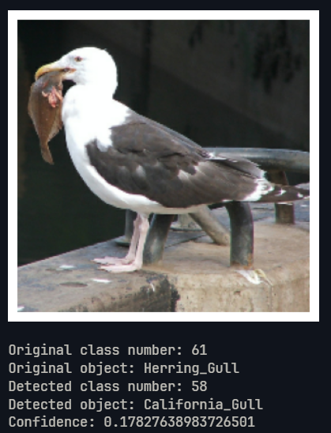

# Klasyfikacja 200 gatunków ptaków (CUB-200-2011) z wykorzystaniem EfficientNetB0

Projekt klasyfikacji wieloklasowej 200 gatunków ptaków na zbiorze **Caltech-UCSD Birds-200-2011** w TensorFlow i Keras z wykorzystaniem transfer learningu **EfficientNetB0**.

---

## Struktura repozytorium
- `main.ipynb` - kompletny notebook z przygotowaniem danych, budową modelu, treningiem, wykresami i ewaluacją
- `README.md` - opis projektu i konfiguracji
- `.gitignore` - wykluczenia dla danych, środowisk i plików tymczasowych

---

## Zestaw danych
- Liczba danych: 200
- Wymiary pojedynczego obrazu i liczba kanałów: 224x224, 3 
- Liczba obrazów w zbiorze treningowym: 5994 
- Wartość validation split i liczba obrazów w zbiorze walidacyjnym: 599 
- Liczba obrazów w zbiorze testowym: 5794 

---

## Architektura modelu 
- Liczba warstw wewnątrz modelu bazowego: 238 
- Klasyfikator: ['global_average_pooling2d', 'dense', 'dropout', 'dense_1'] 
- Liczba parametrów modelu: 4,428,907 
- Liczba parametrów modelu podlegających treningowi: 379,336 

---

## Trening sieci
- **Parametry treningu:**
    - Liczba epok: 10
    - Rozmiar batcha: 64
    - Optymalizator: Adam()
    - Funkcja straty: sparse_categorical_crossentropy
- **Wykres przedstawiający historię treningu:**
<table width="100%">
  <tr>
    <td align="center" width="50%">
      
    </td>
  </tr>
</table>

---

## Skuteczność opracowanego rozwiązania
- **Dokładność (accuracy) na zbiorze:**
    - treningowym: 0.9440 (94.40%)
    - testowym: 0.7135 (71.35%)
- **5 przykładowych zdjęć ze zbioru testowego z podpisem zawierającym klasę rzeczywistą i klasę przewidzianą przez model:**
<table width="100%">
  <tr>
    <td align="center" width="50%">
      
    </td>
    <td align="center" width="50%">
      
    </td>
  </tr>
  <tr>
    <td align="center" width="50%">
      
    </td>
    <td align="center" width="50%">
      
    </td>
  </tr>
  <tr>
    <td align="center" width="50%">
      
    </td>
  </tr>
</table>

---

## Uruchomienie
Notebook można uruchomić w **Google Colab** (zalecane GPU) lub lokalnie w **VS Code**.